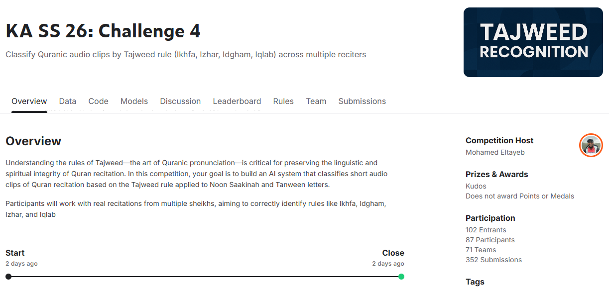
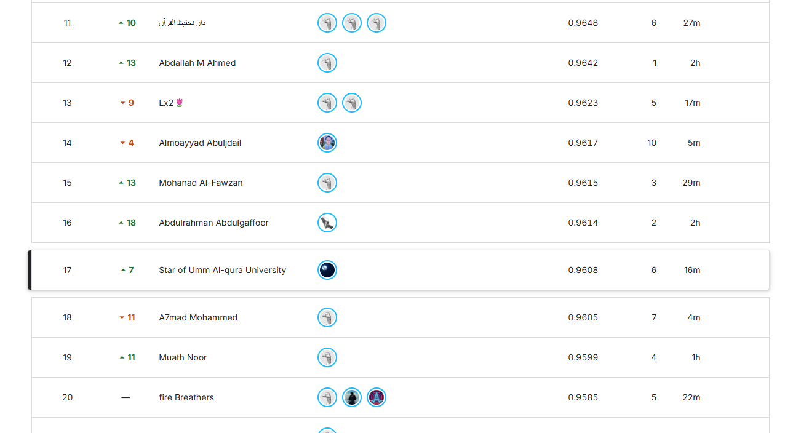
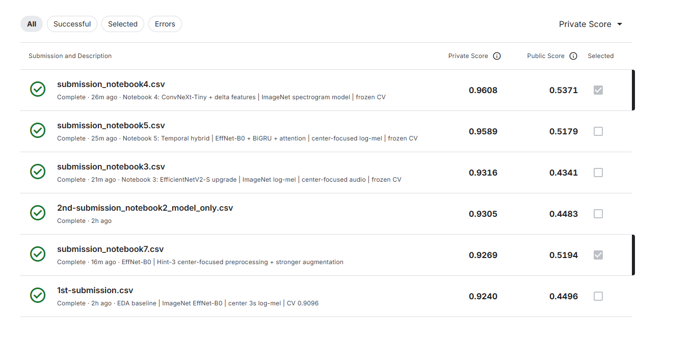

# Tajweed Audio Classification — KAUST Academy Challenge 4

A 4-class audio classification solution developed for **KAUST Academy AI Summer School 2026 — Kaggle Challenge 4**.

The task was to classify Tajweed rules from Quranic recitation audio into four classes:

* `Idgham`
* `Ikhfa`
* `Iqlab`
* `Izhar`

The final solution used **ConvNeXt-Tiny** with a three-channel time-frequency representation combining **log-mel spectrograms, temporal deltas, and delta-deltas**.



## Result

| Metric                       |              Result |
| ---------------------------- | ------------------: |
| OOF Macro-F1                 |          **0.9438** |
| Private Leaderboard Macro-F1 |          **0.9608** |
| Public Leaderboard Macro-F1  |              0.5371 |
| Final Rank                   | **17th / 71 teams** |
| Training Data                |   1,515 audio clips |
| Test Data                    |     747 audio clips |

The public leaderboard represented only **8% of the test set**, while the final ranking was based on the remaining **92% private set**.

Because of that split, model selection relied primarily on frozen cross-validation rather than repeatedly optimizing against the public leaderboard.



## Best Model

The strongest pipeline was:

```text
Audio
  ↓
16 kHz resampling
  ↓
4-second center-focused crop
  ↓
Log-Mel Spectrogram
  ├── Log-Mel
  ├── Temporal Delta
  └── Temporal Delta-Delta
  ↓
3 × 128 × 401 representation
  ↓
ConvNeXt-Tiny
  ↓
4-class Tajweed prediction
```

The backbone used **supervised ImageNet-1K pretrained weights**.

No audio-specific, Quran-specific, or Tajweed-specific pretrained model was used.

## Why ConvNeXt + Delta Features?

The experiments showed that simply increasing model capacity was not enough.

A larger EfficientNetV2-S improved over the earlier baseline, but remained clearly behind the final solution.

The larger gain came from changing **how the audio was represented**.

Instead of giving the model only a log-mel spectrogram, the final system used three meaningful channels:

1. **Log-Mel** — spectral energy over time.
2. **Delta** — first-order temporal changes.
3. **Delta-Delta** — second-order temporal changes.

This representation gives the network information about both the spectral structure of the pronunciation and how that structure changes over time.

ConvNeXt-Tiny then acts as an efficient ImageNet-pretrained convolutional backbone for learning from that structured 2D representation.

## Development Path

The final model was reached through several iterations rather than choosing ConvNeXt immediately.

### 1. EfficientNet-B0 Baseline

The first strong baseline used:

```text
Audio → Log-Mel → ImageNet EfficientNet-B0
```

It produced high cross-validation scores, but the large disagreement between CV and the small public leaderboard made validation quality an important concern.

### 2. Validation and Data Inspection

The dataset was investigated for:

* exact duplicates;
* repeated content;
* class imbalance;
* reciter distribution;
* audio duration;
* anomalous/static recordings;
* train/test acoustic differences.

A fixed **5-fold validation assignment** was then reused for the later serious experiments.

Exact duplicate waveforms were prevented from leaking between training and validation.

One of the most important conclusions was that cross-validation was more useful for **ranking model ideas** than for predicting the absolute hidden leaderboard score.

The final internal ranking was:

```text
ConvNeXt + Delta Features
    >
EfficientNet-B0 + BiGRU/Attention
    >
EfficientNetV2-S
    >
Earlier EfficientNet-B0 variants
```

That ordering later matched the private leaderboard ordering of the serious models.

### 3. Parallel Model Experiments

Three major directions were tested.

#### EfficientNetV2-S

A larger ImageNet-pretrained backbone using the general log-mel approach.

```text
OOF Macro-F1:     0.9199
Private Macro-F1: 0.9316
```

#### EfficientNet-B0 + BiGRU + Attention

A temporal hybrid that preserved the spectrogram time axis and explicitly modeled it using a bidirectional GRU and attention.

```text
OOF Macro-F1:     0.9302
Private Macro-F1: 0.9589
```

#### ConvNeXt-Tiny + Log-Mel + Delta + Delta-Delta

The strongest model.

```text
OOF Macro-F1:     0.9438
Private Macro-F1: 0.9608
```

The comparison suggested that **representation design and inductive bias mattered more than simply increasing backbone size**.

## Audio Preprocessing

The final pipeline used:

| Setting         |      Value |
| --------------- | ---------: |
| Sample rate     |     16 kHz |
| Crop duration   |  4 seconds |
| FFT size        |       1024 |
| Hop length      |        160 |
| Mel bins        |        128 |
| Frequency range | 20–8000 Hz |
| Delta window    |          9 |

Longer clips used a conservative activity-aware centering method.

If the activity detector was uncertain, preprocessing safely fell back to the raw midpoint.

Short clips were symmetrically padded.

No training example was removed solely because it appeared unusual.

## Augmentation

Training used task-preserving augmentation:

* center jitter: **±0.20 s**
* gain: **±6 dB**
* mild time-axis warp: **0.96–1.04×**, `p = 0.30`
* up to two frequency masks
* up to two time masks
* synchronized SpecAugment masks across all three spectrogram channels

The time warp was applied before calculating delta and delta-delta features so the three channels remained internally consistent.

Validation and test preprocessing were deterministic.

## Training

The final model used:

* **ConvNeXt-Tiny**
* supervised ImageNet-1K initialization
* 5-fold cross-validation
* 14 epochs per fold
* AdamW
* learning rate: `2e-4`
* weight decay: `0.05`
* OneCycle learning-rate schedule
* label smoothing: `0.05`
* dropout: `0.30`
* stochastic depth / drop path: `0.10`
* automatic mixed precision

The best checkpoint for every fold was selected using validation Macro-F1.

On a single NVIDIA T4, the five-fold training stage took roughly **10 minutes**, excluding setup and preprocessing.

## Validation Results

Final pooled OOF:

```text
Macro-F1: 0.9438
Accuracy: 0.9413
```

### Per-Class F1

| Class  |     F1 |
| ------ | -----: |
| Idgham | 0.9361 |
| Ikhfa  | 0.9442 |
| Iqlab  | 0.9548 |
| Izhar  | 0.9398 |

### Fold Macro-F1

```text
Fold 1: 0.9476
Fold 2: 0.9263
Fold 3: 0.9533
Fold 4: 0.9321
Fold 5: 0.9600
```

The final model substantially reduced the Idgham/Ikhfa confusion seen in earlier experiments.

## Public vs Private Leaderboard

The most striking result of the competition was the difference between public and private performance.

The final ConvNeXt model scored:

```text
Public:  0.5371
Private: 0.9608
```

The same pattern appeared across several experiments:

| Model                               |  Public F1 | Private F1 |
| ----------------------------------- | ---------: | ---------: |
| ConvNeXt-Tiny + Delta Features      | **0.5371** | **0.9608** |
| EfficientNet-B0 + BiGRU/Attention   |     0.5179 |     0.9589 |
| EfficientNetV2-S                    |     0.4341 |     0.9316 |
| EfficientNet-B0 validation baseline |     0.4483 |     0.9305 |
| Earlier EfficientNet-B0 baseline    |     0.4496 |     0.9240 |



The public leaderboard contained only 8% of the test set, so these scores were highly noisy indicators of final performance.

In contrast, the frozen OOF validation correctly ranked the strongest serious model directions.

That made validation substantially more useful for model selection than the public leaderboard.

## Key Takeaways

The main lessons from the competition were:

* **Representation can matter more than backbone size.**
* Temporal derivatives can give an image-based audio classifier useful information about pronunciation dynamics.
* Strong, label-preserving augmentation should be treated as part of model design rather than a late addition.
* Cross-validation does not need to perfectly predict the hidden score to be useful; correctly **ranking experiments** can be more important.
* Small public leaderboards can be extremely misleading.
* Data inspection, preprocessing, normalization, augmentation, and representation can produce larger gains than blindly scaling the neural network.
* Parallel experiments are valuable when they test genuinely different hypotheses.
* Ensembling only helps when models provide meaningful complementary errors; combining models is not automatically better.

## Repository Contents

```text
.
├── images/
│   ├── overview.png
│   ├── leaderboard.png
│   └── submissions.png
├── 4th_ka_ss_26_challenge_4_convnextv2_deltas.ipynb
└── README.md
```

The notebook contains the full end-to-end pipeline:

```text
competition data
→ preprocessing
→ frozen 5-fold validation
→ spectrogram construction
→ augmentation
→ ConvNeXt training
→ OOF evaluation
→ test inference
→ artifact generation
→ Kaggle submission
```

**Note on the filename:** despite `convnextv2` in the notebook name, the model is **ConvNeXt V1 Tiny**, loaded from the `timm` checkpoint `convnext_tiny.fb_in1k` (supervised ImageNet-1K). The notebook's first cell states this. If that checkpoint cannot be loaded, the notebook falls back to TorchVision's `ConvNeXt_Tiny_Weights.IMAGENET1K_V1`; the committed run used `convnext_tiny.fb_in1k`.

## Reproducing

The notebook was written for and run on **Google Colab with one NVIDIA T4 GPU**.

1. Join the Kaggle competition `ka-ss-26-challenge-4` and download a Kaggle API token (`kaggle.json`).
2. Open the notebook in Colab, select a T4 GPU runtime, and upload `kaggle.json` to `/content/kaggle.json`.
3. Run all cells (**Runtime → Run all**). The notebook:
   * installs `kaggle`, `timm==1.0.26`, `soxr==1.0.0`, and `soundfile==0.13.1` on top of Colab's preinstalled PyTorch and torchaudio;
   * downloads and extracts the competition data into `/content/challenge4_data`;
   * uses the 5-fold assignment embedded in the notebook, checked against stored SHA-256 hashes;
   * writes `submission_notebook4.csv`, the OOF and test probabilities, a config file and a report to `/content/notebook4_outputs/`, plus `/content/notebook4_outputs.zip`.

The seed is fixed at 42 with deterministic cuDNN settings. In the committed run, five-fold training took about 10 minutes and test inference about 12 seconds; the notebook estimates 18–30 minutes end to end, including package installation and data download.

## Notes

This repository is intended as a reproducible record of the modelling approach and competition methodology.

The competition restricted solutions to the provided dataset while allowing generic pretrained weights such as ImageNet.

The final solution was developed within those constraints.
